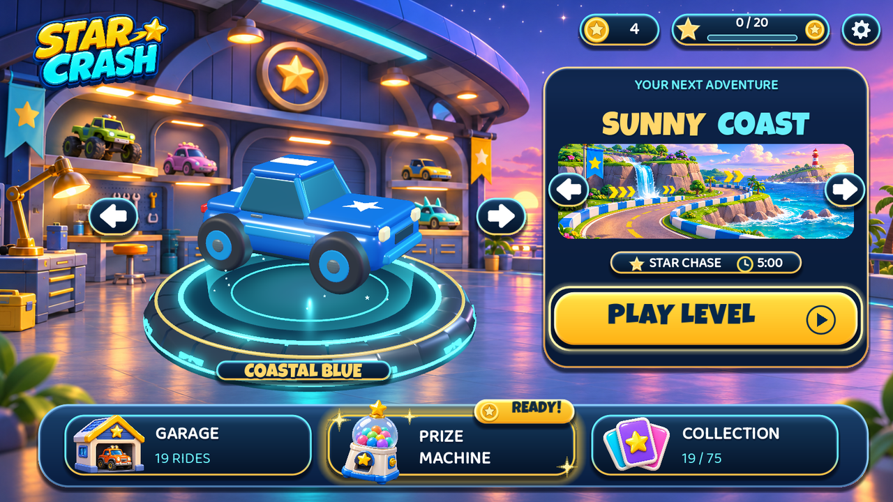

# Star Crash – Coastal Star Chase

A chunky, colourful toy-car arcade game for Windows. Race around Coastal Blue collecting stars, dodge sand, water and oil, zap rivals with power-ups, and win new rides from the Prize Machine. There are 75 cars, including 14 free starters, and each one drives a little differently.

## Download and play
1. Go to **[Releases](../../releases/latest)** and download **`StarCrash-V55.zip`** (about 175 MB).
2. Right-click the zip and choose **Extract All**.
3. Double-click **`StarCrash.exe`**.
4. If Windows shows **"Windows protected your PC"**, click **More info**, then **Run anyway**. That happens because this is a small homemade game, not an app from a big publisher. You only need to do it once.

If Windows says **Smart App Control** blocked the game, that PC only runs apps from known publishers, and Star Crash can't run there.

No install, no account and no internet needed. Your progress saves on your own PC.

## Controls
| Key | Action |
|---|---|
| W / Arrow keys | Drive and steer |
| Space | Fire your power-up |
| Q | Cruise |
| C | Change camera |
| Esc | Pause (lists all the controls) |
| Controller | Stick to drive, A / RT to fire, Start to pause |

Mouse and touch work in the menus. On a touchscreen, on-screen driving buttons appear automatically. You can turn them on or off in **Settings**.

## How it works
- Collect **Star Coins** in a **5-minute star chase** against five rivals. Gold coins are worth 1 star, rare silver **Big** coins 5, and very rare jewelled **Mega** coins 20.
- **Sand and water** slow you down, and **oil** spins you around.
- Hit palms, street lamps, lifeguard stands and road barricades **fast** to smash them. A slow bump just stops you.
- Every **20 stars** you collect makes **1 coin**.
- Spend **3 coins** in the **Prize Machine** to win a new ride.
- Every ride is a **Racer, Zippy, Off-Road, Heavy or All-Rounder**.
- Pick what to drive in the **Garage**, and see all 75 rides and set medals in your **Collection**.

## Requirements
Windows 10 or 11 (64-bit), with a graphics card that supports Vulkan or DirectX 12. Most PCs from the last several years do.

## Credits
- **Music:** the "For Racing Game" collection by MintoDog (CC0), from [OpenGameArt](https://opengameart.org/content/for-racing-game-mintodogs-music).
- **Crash and tire screech sounds:** "FREE CAR SFX" by LMGLolo ([CC BY-ND 4.0](https://creativecommons.org/licenses/by-nd/4.0/)), used unmodified, from [itch.io](https://lmglolo.itch.io/free-car-sfx).
- **Hit, explosion and pickup glow effects:** [Binbun](https://binbun3d.itch.io/) (CC0).
- **Boats, race dressing, street lamps, mystery box, particles and impact sounds:** [Kenney](https://kenney.nl) (CC0).
- **Lawn flowers and plants:** [flo-bit](https://flo-bit.itch.io/) "Low Poly Nature Pack" (CC0).
- **Star Coins:** designed after Monster Rally (Simple Kids Games).

This repo only holds the game download, not the source code.
